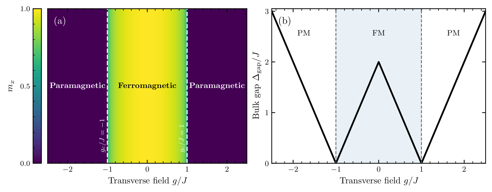
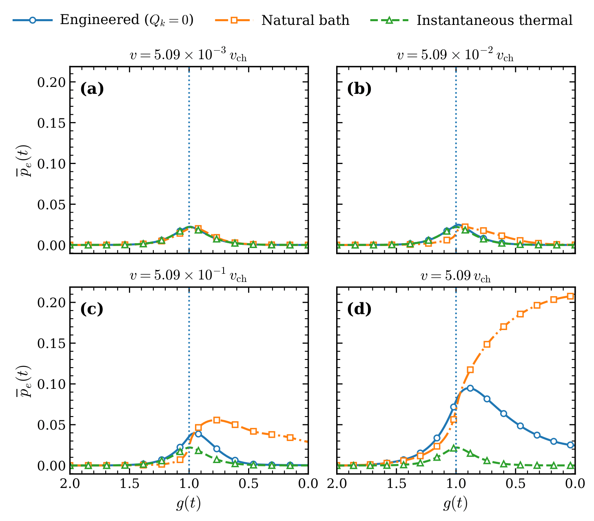
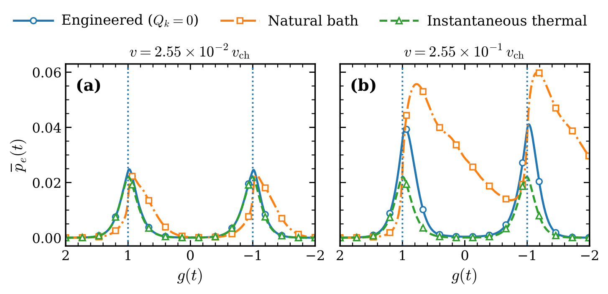
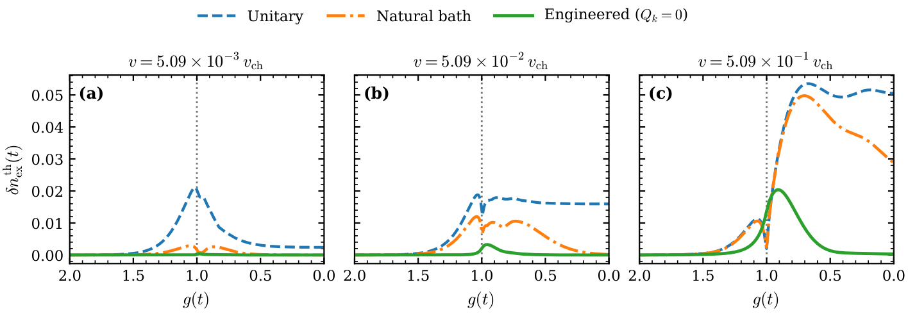
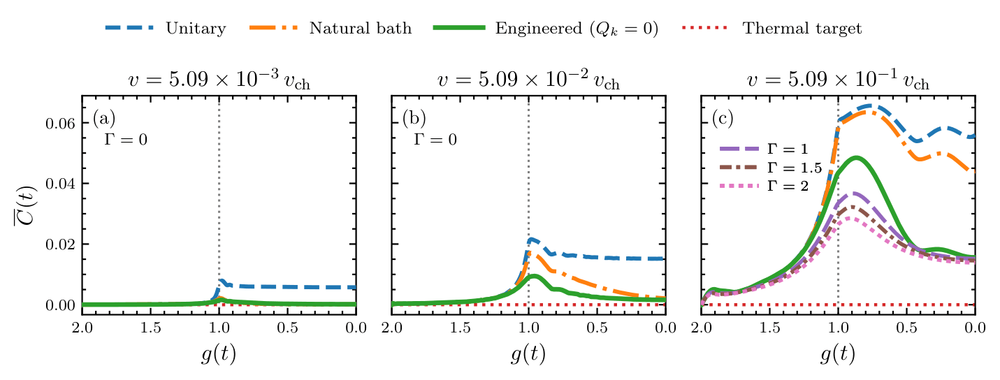
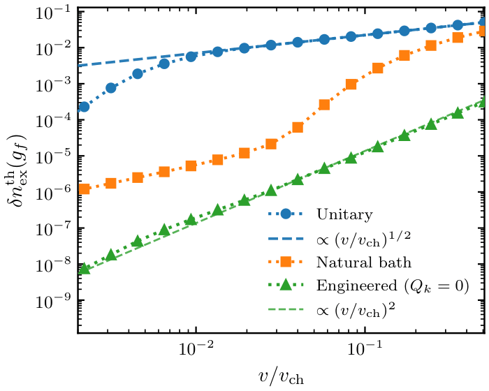

# Saikat Mistry

**Quantum condensed matter physics · Open quantum systems · Non-equilibrium dynamics**

I completed my Master's in Physics at the Indian Institute of Science Education and Research (IISER) Bhopal. My research explores how controlled dissipation can guide quantum systems during finite-time driving, particularly near quantum critical points.

This website presents my research, numerical results, and the physical ideas behind them.

[Research overview](#research-overview) · [The protocol](#the-protocol) · [Results](#results) · [Outlook](#outlook) · [Contact](#contact)

---

## Research overview

### Engineered Dissipation for Thermal-State Tracking Across Quantum Criticality

**Saikat Mistry, Dibyajyoti Sahu, and Suhas Gangadharaiah**  
Department of Physics, IISER Bhopal

[Read the paper](https://arxiv.org/abs/2609.39084)
<!-- Add the verified arXiv abstract-page URL here when available. -->

Preparing a quantum system in a desired state becomes difficult when its Hamiltonian changes rapidly. Near a quantum critical point, the energy gap becomes small, and finite-time driving generates excitations and coherence. A conventional thermal environment can relax the system, but it does not necessarily keep pace with a continuously changing thermal target.

In this work, we construct time-dependent dissipative transition rates to reproduce the population redistribution required by an instantaneous thermal state. The rates remain non-negative, preserving the Markovian Gorini-Kossakowski-Sudarshan-Lindblad (GKSL) form of the generator. We test the construction in a driven transverse-field Ising chain and compare it with isolated unitary evolution and a natural thermal bath.

The numerical results show strongly reduced deviations from the thermal target, suppression of dynamically generated coherence, and a residual thermal deviation approaching quadratic slow-driving behavior over the range studied.

## Model and driving protocol

We consider a one-dimensional transverse-field Ising chain with nearest-neighbor coupling **J** and a time-dependent transverse field **g(t)**:

**H(t) = −J ∑ⱼ σˣⱼ σˣⱼ₊₁ − g(t) ∑ⱼ σᶻⱼ.**

The Jordan-Wigner and Fourier transformations reduce the model to independent two-level momentum sectors. In the convention used in the paper, their Hamiltonians are

**Hₖ(t) = 2[(g(t) − J cos k)σᶻ + J sin k σˣ].**

With **J = 1**, the quantum critical points lie at **g = ±1**. The primary linear ramp runs from **g = 2 to g = 0**, crossing the critical point at **g = 1**. An extended ramp from **g = 2 to g = −2** tests the protocol across both critical points.

The finite-chain analysis uses **L = 128 spins**, corresponding to **64 positive-momentum sectors**, with antiperiodic momenta **k = (2m + 1)π/L** in the even-parity sector.

*Figure 1. Zero-temperature equilibrium phase structure: spontaneous magnetization distinguishes the ferromagnetic and paramagnetic regions, while the bulk quasiparticle gap closes at g/J = ±1. This provides the equilibrium context for the driven finite-temperature study.*

## The protocol

### A changing thermal target

For each momentum sector, the target is the instantaneous Gibbs state of **Hₖ(t)** at a prescribed inverse temperature **β**. Its ground- and excited-state probabilities are denoted by **λ₀,ₖ(t)** and **λ₁,ₖ(t)**.

The target state changes as the energy spectrum changes. Unitary dynamics alone cannot produce the required change in the eigenvalues of the density matrix, so a dissipative contribution is needed to redistribute populations.

The prescribed target **ρ★,ₖ(t)** and the actual evolving state **ρₖ(t)** are distinct: finite-time driving can generate both population errors and coherence in the instantaneous energy basis. The protocol improves tracking; it does not assume that the actual state follows the target exactly.

### Non-negative transition currents

Let **W₁₀,ₖ** be the excitation rate and **W₀₁,ₖ** the relaxation rate. Evaluated on the target populations, the required net current satisfies

**dλ₁,ₖ/dt = W₁₀,ₖ λ₀,ₖ − W₀₁,ₖ λ₁,ₖ.**

Using **[x]₊ = max(x, 0)**, we choose the two directional currents as

- **I₁₀,ₖ = [dλ₁,ₖ/dt]₊ + Qₖ**,
- **I₀₁,ₖ = [−dλ₁,ₖ/dt]₊ + Qₖ**,

where **Qₖ ≥ 0** is a common current. Dividing these currents by their source-state target probabilities gives the transition rates:

- **W₁₀,ₖ = I₁₀,ₖ / λ₀,ₖ**,
- **W₀₁,ₖ = I₀₁,ₖ / λ₁,ₖ**.

For full-rank finite-temperature targets, both denominators are positive and the resulting rates are non-negative. The numerical study primarily uses **Qₖ = 0**, the minimal-current realization, which activates only the transfer direction required by the changing target.

The common current cancels from the prescribed net transfer. Increasing it strengthens bidirectional dissipative activity and coherence damping without changing that target-current condition. During actual evolution, the rates act on the actual populations, so this condition alone does not guarantee exact tracking.

## Results

### Following the thermal population

The engineered protocol keeps the mode-averaged excited-state population closer to the instantaneous thermal population than the natural-bath reference. Tracking deteriorates as the ramp becomes faster, but the engineered dynamics continue to reduce the departure in the cases studied.

*Figure 2. Mode-averaged excited-state population during the g = 2 → 0 ramp at four driving rates. Engineered dynamics with Qₖ = 0 are compared with a natural thermal bath and the instantaneous thermal target. The dotted line marks g = 1.*

### Tracking through two critical points

The improvement persists for a ramp crossing both **g = 1** and **g = −1**, providing a robustness test beyond a single critical passage.

*Figure 3. Mode-averaged excited-state population during the g = 2 → −2 ramp at two driving rates, comparing engineered dynamics, natural-bath dynamics, and the instantaneous thermal target.*

### Measuring the thermal deviation

At finite temperature, an excited-state population is not automatically an error: the thermal target already contains excited-state occupation. We therefore measure the mean absolute difference between the actual and target excited-state populations:

**δnᵗʰₑₓ(t) = (1/Nₖ) ∑ (k > 0) |pₑ,ₖ(t) − λ₁,ₖ(t)|**, where the sum runs over positive momenta.

This population-based measure reduces to the conventional excitation density when the target excited-state occupation vanishes. It does not, by itself, measure all differences between density matrices; coherence is assessed separately.

*Figure 4. Thermal excitation deviation during the primary ramp for unitary, natural-bath, and engineered dynamics at three driving rates. Engineered dissipation strongly reduces the deviation, including the residual departure after the critical crossing.*

### Controlling coherence damping

The instantaneous thermal target has no off-diagonal coherence in the energy basis. Finite-time driving generates such coherence, while the engineered transition channels damp it at a rate proportional to **(W₀₁,ₖ + W₁₀,ₖ)/2**.

To explore the available freedom, we use **Qₖ = Γ λ₀,ₖ λ₁,ₖ**. Increasing **Γ** produces additional coherence suppression while preserving the prescribed net target-population current.

*Figure 5. Mode-averaged absolute coherence in the instantaneous energy basis. The minimal-current protocol is compared with unitary and natural-bath dynamics; the fastest-ramp panel also shows Γ = 1, 1.5, and 2, in units of J/ℏ.*

### Residual deviation and driving-rate scaling

The final thermal excitation deviation is evaluated at the end of the ramp and plotted against **v/vch**. For the primary protocol, the paper defines the finite-size reference rate as **vch = |gf − gi| Δmin ≈ 0.196**, with **J = ℏ = 1**.

- **Unitary evolution:** an intermediate-rate regime follows the familiar **(v/vch)¹ᐟ²** Kibble-Zurek reference behavior. At sufficiently slow driving, the finite-size gap produces a departure from this thermodynamic regime.
- **Natural thermal bath:** the rate dependence shows a crossover associated with competing driving and relaxation timescales.
- **Engineered dissipation:** the residual deviation is strongly suppressed and approaches the **(v/vch)²** reference behavior over a broad range of driving rates.

*Figure 6. Final thermal excitation deviation for the three dynamical cases. Dashed lines show the one-half and quadratic reference power laws; they are comparison guides, not fitted exponents. The results do not establish a universal quadratic exponent for all sizes, temperatures, or protocols.*

## Outlook

The framework suggests a way to use dissipation as a control resource for finite-time thermal-state preparation near quantum criticality. Further directions include testing size and temperature dependence, optimizing the common current under bounds on available rates, and extending the construction to interacting systems beyond independent quadratic sectors.

Experimental implementation requires a mapping from momentum-resolved transition channels to accessible controls. These channels may be nonlocal in the spin representation, and practical rate magnitudes, control bandwidth, and reservoir response times remain important constraints.

## Contact

**Saikat Mistry**  
[saikat23@iiserb.ac.in](mailto:saikat23@iiserb.ac.in) · [GitHub](https://github.com/saikat3431)

<!-- SETUP NOTES (hidden on the rendered page)
Upload the paper as papers/engineered-dissipation.pdf.
Upload the six figure images under images/ using the exact filenames above.
Image links will display once the corresponding files have been uploaded.
These are suggested filenames, not the original figure filenames.
Use PNG exports for these links, or change each extension to match your files.
Add the verified arXiv URL near the paper title when available.
-->
